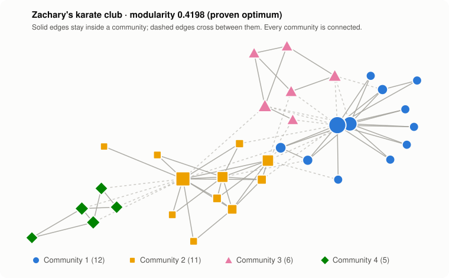
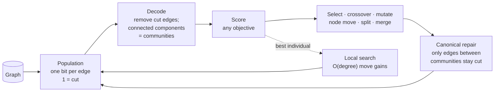

<div align="center">

# ERBGA

**Community detection that always returns connected communities, and optimises any objective you can write in Python.**

[](https://github.com/adityak74/ERBGA/actions/workflows/erbga-py.yml)


[](LICENSE)

<picture>
  <source media="(prefers-color-scheme: dark)" srcset="erbga_py/docs/karate-dark.svg">
  
</picture>

[Quickstart](#quickstart) · [Results](#results) · [How it works](#how-it-works) · [For AI agents](#use-it-from-an-ai-agent) · [Docs](erbga_py/README.md)

</div>

---

ERBGA (*Efficient Reduced-Bias Genetic Algorithm*) searches over **which edges to cut**. Communities are whatever stays connected, so a disconnected community cannot be represented, let alone returned. The search never looks inside the objective, so modularity is just the default: swap in Qs, or any `f(graph, labels) -> float`, and the same algorithm optimises it.

- **Connected by construction.** Louvain can return communities that fall apart into disconnected pieces; fixing that was Leiden's headline result in 2019. ERBGA's encoding rules it out.
- **Any objective.** Modularity and Qs are built in. Your own function needs no gradients, no special form and no changes to the algorithm.
- **Reaches proven optima.** It finds the exact maximum modularity on all four classic benchmarks, in seconds.
- **Built for agents.** It ships an MCP server, a JSON-only CLI mode with structured errors, and an [`llms.txt`](erbga_py/llms.txt).
- **Can improve itself with an LLM.** `erbga evolve` has Claude write new mutation operators, then keeps the ones that score better.

## Quickstart

```bash
pip install "erbga @ git+https://github.com/adityak74/ERBGA.git#subdirectory=erbga_py"

erbga detect karate --seed 0
# karate: 34 nodes, 78 edges, objective=modularity
# best modularity = 0.419790 with 4 communities (111 generations, 1532 evaluations, 1.46s)
```

Bring your own graph as an edge list (`u v` per line), `.gml`, or `.json`:

```bash
erbga detect my_graph.txt --objective qs --format json > communities.json
erbga score my_graph.txt partition.json   # score another tool's partition: {"node": community, ...}
```

Or from Python:

```python
from erbga import detect_communities
from erbga.api import load_graph

result = detect_communities(load_graph("football"), "modularity", seed=0)
result.fitness            # 0.6044 (the proven optimum is 0.6046)
result.communities        # {node_id: community}

# any objective: higher is better
def fewer_big_communities(graph, labels):
    return -float(labels.max())

detect_communities(load_graph("football"), fewer_big_communities, seed=0)
```

## Results

**Classic benchmarks.** Ten seeds each, default settings. The optimum is the proven maximum modularity from [Aloise et al. (2010)](https://doi.org/10.1103/PhysRevE.82.046112).

| Graph | Nodes | Edges | Proven optimum | ERBGA best | Mean of 10 | Time per run |
|---|---:|---:|---:|---:|---:|---:|
| Karate club | 34 | 78 | 0.4198 | **0.4198** | 0.4198 | 1.4 s |
| Dolphins | 62 | 159 | 0.5285 | **0.5285** | 0.5274 | 2.4 s |
| Political books | 105 | 441 | 0.5272 | **0.5272** | 0.5272 | 2.2 s |
| College football | 115 | 613 | 0.6046 | **0.6046** | 0.6045 | 4.0 s |

**Scaling.** Graphs with 10 planted communities and average degree about 7. ERBGA finds partitions that score higher than the planted ones.

| Nodes | Edges | Planted modularity | ERBGA | Time |
|---:|---:|---:|---:|---:|
| 500 | 1,668 | 0.6363 | **0.6400** | 5 s |
| 1,000 | 3,407 | 0.6290 | **0.6323** | 9 s |
| 2,000 | 6,857 | 0.6374 | **0.6411** | 17 s |
| 5,000 | 16,961 | 0.6344 | **0.6370** | 33 s |

Reproduce both tables with `python benchmarks/run_datasets.py` and `python benchmarks/scaling.py` (run from `erbga_py/`).

### Where it fits

| | Louvain | Leiden | Infomap | **ERBGA** |
|---|---|---|---|---|
| Objective | modularity (and variants) | modularity, CPM | map equation | **any Python function** |
| Communities guaranteed connected | no | yes | not guaranteed | **yes, by construction** |
| Speed | milliseconds, millions of nodes | milliseconds, millions of nodes | fast | seconds to tens of seconds at 1–5k nodes |
| Search | greedy + aggregation | greedy + refinement + aggregation | greedy + aggregation | genetic population + greedy + aggregation |

Reach for Leiden when you need modularity on a huge graph, fast. Reach for ERBGA when you want to optimise something those methods can't, such as a reduced-bias score, a domain-specific quality measure, or a constraint written as a penalty, without losing connectivity.

## How it works



1. **Encoding.** A chromosome has one bit per edge. Decoding removes the cut edges and labels the connected components with vectorised union-find.
2. **Canonical repair.** Cut edges inside a community change nothing, so they are restored. Every chromosome then maps to exactly one partition, and fitness is cached on it.
3. **Variation.** Tournament selection and crossover, plus mutation operators that work at the community level: move a node, split a community, or merge two. Elitism keeps the best score from ever going down. Optionally, the population is split into islands that swap their best members every few generations (`--islands 4`).
4. **Local search.** Greedy moves on the best individual, Louvain-style: first single nodes, then, once those stall, whole communities on a collapsed graph, so communities can merge. For modularity and Qs each move is scored in O(degree) from per-community totals. The result is decoded again, so communities stay connected.

The [package README](erbga_py/README.md) covers the design in depth and compares it with the 2018 C++ implementation.

## Use it from an AI agent

ERBGA ships an [MCP](https://modelcontextprotocol.io) server, so Claude and other agents can call it directly:

```bash
pip install "erbga[mcp] @ git+https://github.com/adityak74/ERBGA.git#subdirectory=erbga_py"
```

```json
{ "mcpServers": { "erbga": { "command": "erbga", "args": ["mcp"] } } }
```

The tools are `list_datasets`, `list_objectives`, `graph_summary`, `detect_communities` and `score_partition`. A graph can be a dataset name, a file path, or inline `{"edges": [[u, v], ...]}`. Failures come back as `{"ok": false, "error": {"code", "message", "hint"}}`, so the model can fix its input and retry.

Every CLI command also takes `--format json`, which prints exactly one JSON object on stdout and exits with 0 or 1. [`llms.txt`](erbga_py/llms.txt) is the full reference for models, and [`AGENTS.md`](erbga_py/AGENTS.md) guides coding agents working on the repo.

### Let Claude invent operators

```bash
pip install "erbga[evolve] @ git+https://github.com/adityak74/ERBGA.git#subdirectory=erbga_py"
erbga evolve --iterations 20                 # needs ANTHROPIC_API_KEY
erbga detect football --operator evolve_runs/<run>/best_operator.py
```

This is a FunSearch-style loop. Claude writes `mutate(graph, labels, rng)` functions, and each one passes an import allowlist before it is scored in a separate, time- and memory-limited process against a fixed-seed baseline. The best is saved and can be plugged straight back in. Those limits are not a security sandbox, so run it in a container if that matters to you.

## Repository map

| Path | What's there |
|---|---|
| [`erbga_py/`](erbga_py) | **The Python package**: library, CLI, MCP server, tests, benchmarks |
| [`bfs_orig/`](bfs_orig) | The original 2017–2018 C++ implementation ([notes](bfs_orig/README.md)) |
| [`bfs_sc/`](bfs_sc) | The breadth-first-search network library it was built on |
| [`Graph-Networks Dataset/`](Graph-Networks%20Dataset) | Benchmark graphs and reference papers |
| [`Experiment_Data/`](Experiment_Data) | Results from the original runs |

## Roadmap

- [x] Python rewrite that reaches the proven optima on the classic benchmarks
- [x] MCP server, JSON CLI, `llms.txt`
- [x] LLM-evolved mutation operators
- [x] Incremental local search (up to 39× faster)
- [x] Island model (`--islands`), ported from the 2018 branch
- [ ] Faster decoding past ~10k nodes (incremental components or compiled code)
- [x] Louvain-style aggregation inside local search
- [ ] LFR benchmarks with NMI/ARI against Louvain, Leiden and Infomap
- [ ] Multi-objective search (NSGA-II over modularity and Qs)
- [ ] Weighted graphs
- [ ] Publish to PyPI

## Contributing

```bash
cd erbga_py
pip install -e ".[test]"
pytest -q && ruff check .
```

CI runs both on Python 3.10–3.13. [`AGENTS.md`](erbga_py/AGENTS.md) lists the invariants the tests enforce. It is written for coding agents, but it is just as useful for people.

## Citation

If ERBGA helps your research, please cite it. GitHub's **"Cite this repository"** button uses [`CITATION.cff`](CITATION.cff).

## License

[MIT](LICENSE) © 2017–2026 Aditya Karnam. That covers the ERBGA code in this repository: the Python package and the genetic algorithm in `bfs_orig/`. Third-party code keeps its authors' terms. That includes the network library in `bfs_orig/` and `bfs_sc/` (Sharlee Climer; marked in the file headers) and `GML_XGMML/` (John Punin, based on Marcus Raitner's GML parser).

## Background

ERBGA started as Aditya Karnam's graduate research in Sharlee Climer's lab at the University of Missouri–St. Louis (UMSL), completed in 2018. That work was a C++ genetic algorithm built on the lab's network library and run on the Lewis HPC cluster. The aim was community detection that isn't tied to one objective's biases, such as modularity's resolution limit. The Python package is a 2026 rewrite of that idea, with a new encoding repair, community-level operators and incremental local search.

The benchmark graphs come from [Mark Newman's network data collection](http://www-personal.umich.edu/~mejn/netdata/): karate club (Zachary, 1977), dolphins (Lusseau et al., 2003), political books (V. Krebs) and college football (Girvan & Newman, 2002).
